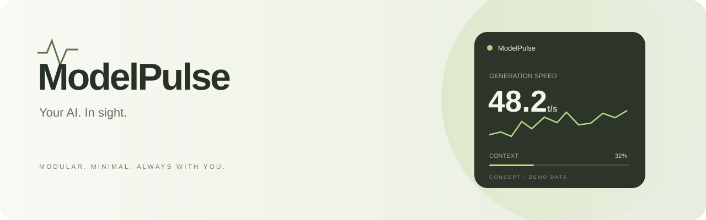
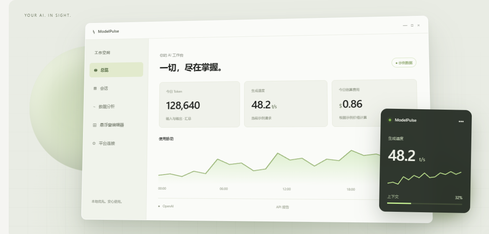

<p align="center"></p>

<h1 align="center">ModelPulse</h1>
<p align="center"><strong>看见模型的每一次脉动。</strong><br>为 Windows 设计的组件化大模型实时监控中心。</p>
<p align="center">
  
  
  
</p>
<p align="center"><a href="https://modelpulse.grandgoose64.chatgpt.site/">访问官网 ↗</a> · <a href="#组件化你的工作台">组件化</a> · <a href="#悬浮窗让数据随你工作">悬浮窗</a> · <a href="#开发路线">开发路线</a></p>

> **项目状态**：当前仓库包含已经上线的宣传官网及交互演示。原生桌面应用仍处于规划阶段，暂无安装包。页面中的数值、图表和产品界面均为概念演示数据。

## 一切，尽在掌握

ModelPulse 希望把分散在不同平台的模型使用信息，汇聚成一个轻巧、清晰、可定制的 Windows 工作台。从 Token 用量到生成速度，从费用估算到上下文占用，让你更从容地理解每一次调用。

<p align="center"><br><sub>产品概念预览 · 示例数据 · 最终桌面实现可能调整</sub></p>

| 用量 | 性能 | 费用 | 状态 |
| :--- | :--- | :--- | :--- |
| 输入 / 输出 Token、累计使用 | 生成速度、调用耗时 | 根据可用用量和价格估算 | 模型、连接与上下文信息 |

以上为产品规划，数据可用性取决于具体平台和接入方式。

## 组件化，你的工作台

**信息可以自由组合，界面应该顺应你的工作习惯。**

- **自由搭配**：按需要添加 Token、速度、费用、上下文等组件。
- **独立配置**：每个组件拥有自己的数据源、显示内容与外观设置。
- **布局预设**：为编程、写作、分析保存不同的监控视图。
- **持续扩展**：以统一的组件模型承载未来的指标与接入方式。

官网已提供组件选择、排序与场景预设的交互演示。

## 悬浮窗，让数据随你工作

把关键组件带到桌面上，让关注的信息始终在视线之内。

| 规划能力 | 使用体验 |
| :--- | :--- |
| 置顶、移动与调整尺寸 | 将监控窗放在顺手的位置 |
| 紧凑 / 展开视图 | 在简洁读数和更多细节间切换 |
| 透明度与明暗外观 | 融入不同桌面和工作环境 |
| 鼠标穿透 | 查看数据时减少对操作的干扰 |
| 多显示器与 DPI 适配 | 在不同屏幕上保持清晰 |
| 快捷键、托盘与启动设置 | 快速唤起自己的工作台 |

官网可以体验紧凑与展开切换、透明度和明暗外观。桌面置顶、穿透等系统能力将在原生应用阶段实现。

## 让每个数字都有来处

透明的数据来源，是这个产品的设计原则。

| 来源 | 呈现原则 |
| :--- | :--- |
| API 或客户端明确报告 | 标注为报告数据，并保留来源 |
| Tokenizer 计算 | 明确标注为估算 |
| 根据可用信息推断 | 展示推断依据和局限 |
| 无法获得的数据 | 显示不可用，不编造读数 |

累计 Token 不等于当前上下文占用；费用估算不等于实际账单。计划优先在本地处理和保存数据，并提供清晰的数据管理选项。

### 接入方向

计划逐步支持直接 API 调用、可选的本地代理、官方客户端可访问的日志或报告，以及本地 Tokenizer 估算。各平台的适配范围将在实现和验证后公布。

## 当前进展

- [x] 简约官网与公开访问
- [x] 响应式布局、移动导航与 FAQ
- [x] 组件化选择、排序和场景演示
- [x] 悬浮窗外观与透明度演示
- [x] 动态图表、滚动动画及减少动态效果适配
- [ ] Windows 原生桌面应用
- [ ] 真实数据接入、持久化与费用规则
- [ ] 安装包、升级与发布流程

## 本地预览官网

安装 Node.js 后运行：

```sh
git clone https://github.com/Xiaoheixu/ModelPulse.git
cd ModelPulse
node server.cjs
```

在浏览器打开 [本地预览](http://127.0.0.1:4173)。官网使用原生 HTML、CSS 和 JavaScript，无需安装 npm 依赖。

```text
ModelPulse/
├── index.html      页面内容与交互结构
├── style.css       响应式样式与动画
├── app.js          演示数据与页面交互
├── server.cjs      本地预览服务
├── banner.svg      README 品牌横幅
├── preview.png     产品概念预览
└── README.md       项目介绍与路线
```

## 开发路线

桌面端按照以下阶段逐步推进；这里是计划，不代表已完成或承诺发布日期。

1. 项目基础：Windows 应用框架与分层结构。
2. 核心模型：会话、指标、数据来源和存储。
3. 组件系统：独立配置与可组合的监控视图。
4. 悬浮窗口：置顶、尺寸、透明度和桌面交互。
5. 布局编辑器：组合、保存与复用工作台。
6. 真实 API：用量、耗时和费用规则。
7. 本地代理：可选的请求观测入口。
8. 客户端适配：按平台能力验证接入方式。
9. 发布与打磨：测试、性能、安装和升级。

<details>
<summary><strong>计划中的桌面技术栈</strong></summary>

- C#、WinUI 3 与兼容的 .NET 版本
- MVVM 与通用 Host 服务管理
- SQLite 本地存储
- HttpClient 与可选 YARP 代理
- JSON 配置、结构化日志与必要的自动化测试

核心逻辑与界面分离，主窗口和悬浮窗共享同一份指标状态。

</details>

## 参与讨论

欢迎在 [Issues](https://github.com/Xiaoheixu/ModelPulse/issues) 分享使用场景、组件想法或官网问题。反馈接入问题时，请先移除 API 密钥及敏感日志。

---

<p align="center"><strong>Your AI. In sight.</strong><br><sub>原生桌面软件规划中 · 官网已上线</sub><br><a href="https://modelpulse.grandgoose64.chatgpt.site/">ModelPulse 官网 ↗</a></p>
